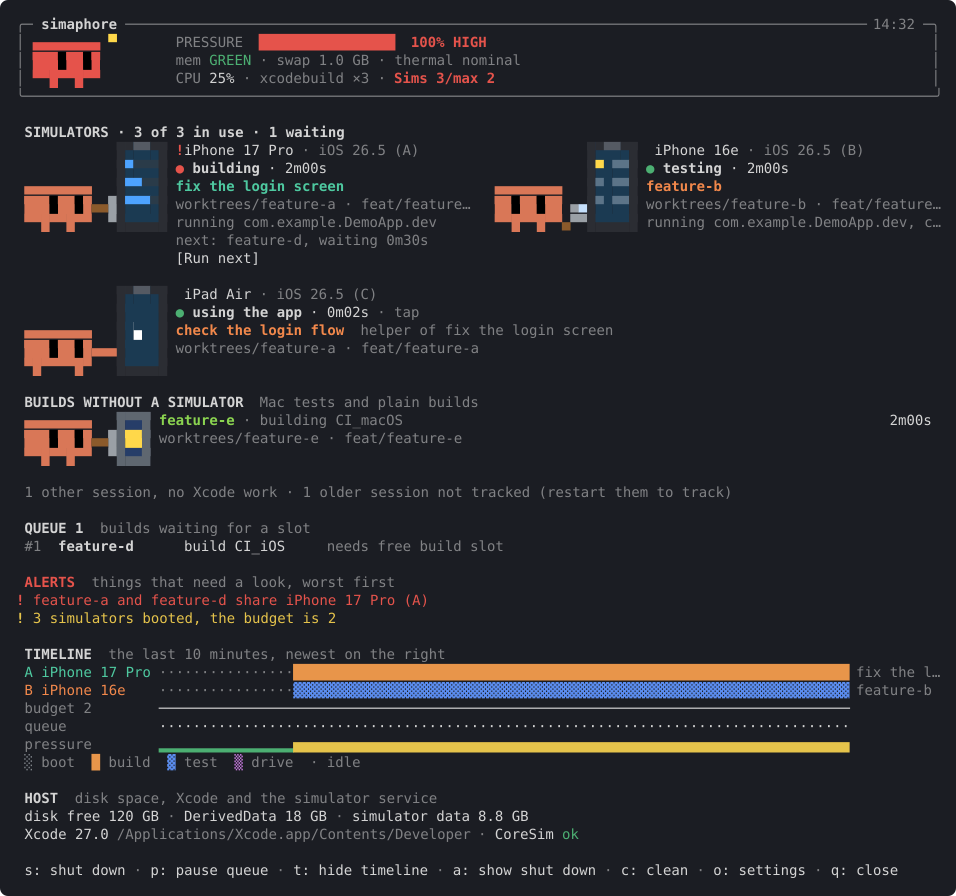
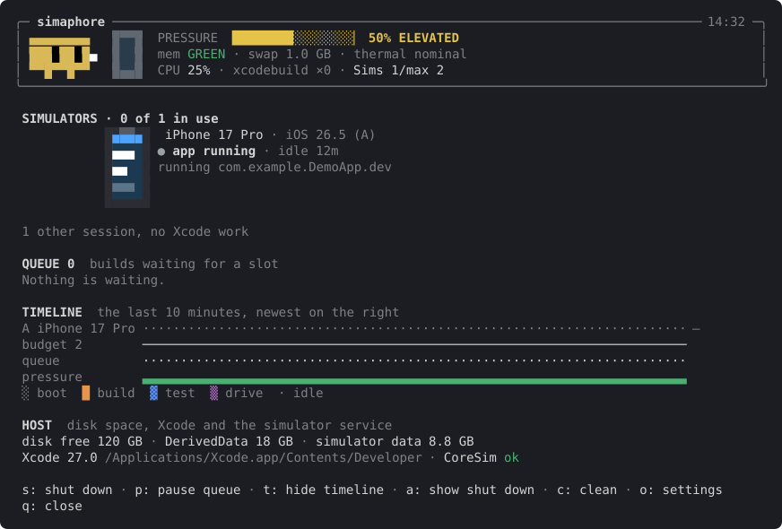
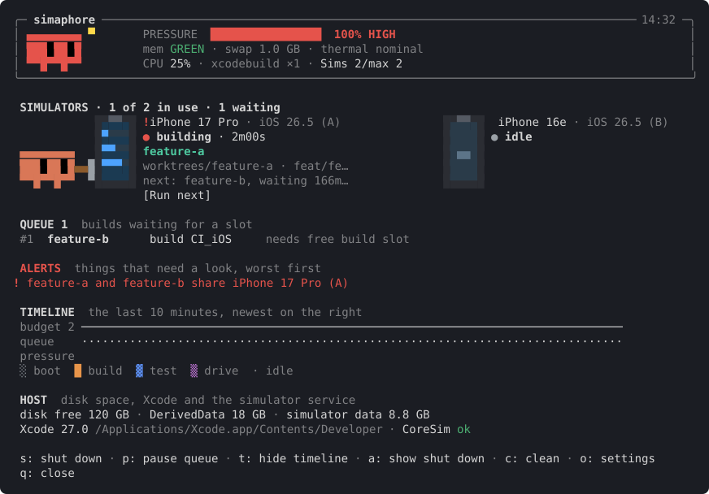
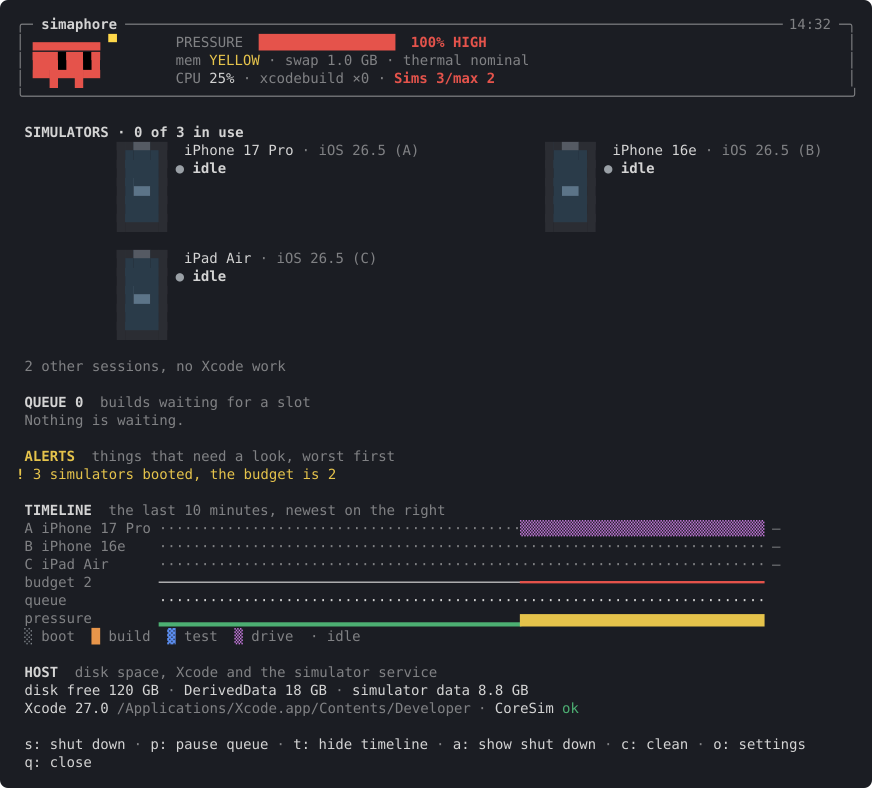
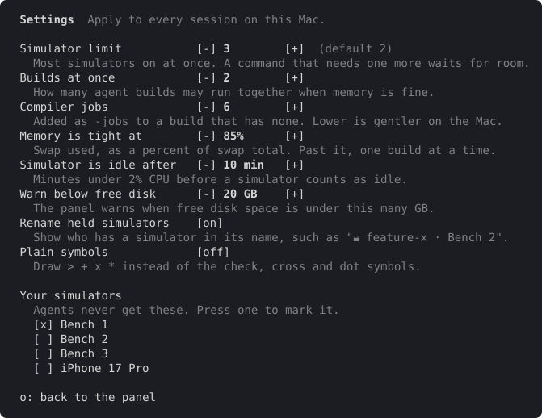

# simaphore

**Traffic lights for iOS simulators and Xcode builds, for when several Claude Code agents share one Mac.**

Run a few agents at once and they all start building and booting simulators together.
The Mac slows to a crawl, two agents fight over the same simulator, and nobody knows
who is doing what. simaphore keeps order: builds wait their turn, each agent gets its
own simulator, and a live panel shows it all.



## Why you might want it

- You run several Claude Code sessions on one app, often in separate git worktrees.
- Your Mac gets hot and slow when two or three agents build at the same time.
- Agents step on each other's simulators: one shuts down the device another is testing on.
- You want to see, at a glance, what every agent is doing right now.

## What you need

- A Mac with Xcode installed (simulators come with it).
- Claude Code 2.1.275 or later.

## Install

Inside Claude Code:

```
/plugin install simaphore --marketplace omaestra/simaphore
```

Then restart your Claude Code sessions so they pick it up.

## Quick start

1. In any session, type `/simaphore`. The panel opens.
2. That is all. While the panel is open, simaphore is **on** for every session on
   your Mac. Close the last panel and it switches **off** again.

Nothing runs behind your back: if you never open the panel, simaphore does not
change how anything works. It only keeps a quiet list of which agent is doing what,
so the panel has something to show when you open it.

## What it does for you

### 1. See every agent at once

Each Claude session shows up as a row: what it is doing (building, testing, using
the app, waiting), for how long, which simulator it holds, and which folder and
branch it works in. A new session that opens the panel sees all the others straight
away.



### 2. Builds wait their turn

When the Mac is busy, a new build does not start on top of the others. It waits in
a queue and starts when there is room. You can see who is waiting, and for what.
Press `p` to pause the queue.



### 3. Each agent gets its own simulator

An agent that uses a simulator holds it, and others are asked to pick another one.
A held simulator is renamed (for example "🔒 feature-x · Bench 2") so you can see
who has it. It is freed when the agent finishes, or after 10 minutes unused.

### 4. A cap on how many simulators run

Simulators are heavy. simaphore keeps the number that are on under a limit you set.
When an agent needs one more, it waits, and an idle simulator that an agent used is
shut down to make room. Anything over the limit shows as a warning.



### 5. Your own simulators stay yours

The simulator you are debugging on in Xcode is never handed to an agent. You can
also mark any simulator as yours in the settings.

### 6. You are in control

Turn simaphore off and everything is let go at once: waiting builds start, holds
are dropped, simulators get their names back. Builds already running keep running.

### 7. Fits small windows

In a narrow window the panel shrinks to a single line.


## Settings

Press `o` in the panel (or type `/simaphore settings`) to change things without
editing any file. Changes apply to every session on this Mac.



| Setting | What it does | Default |
| --- | --- | --- |
| Simulator limit | Most simulators on at once | 2 |
| Builds at once | How many agent builds may run together when memory is fine | 2 |
| Compiler jobs | Added as `-jobs` to a build that has none. Lower is gentler | 6 |
| Memory is tight at | Swap used, as a percent of the total. Past it, one build at a time | 85% |
| Simulator is idle after | Minutes under 2% CPU before a simulator counts as idle | 10 |
| Warn below free disk | The panel warns under this many GB free | 20 |
| Rename held simulators | Show who has a simulator in its name | on |
| Plain symbols | Use `> + x *` instead of special symbols | off |
| Your simulators | Simulators agents never get | none |

The same settings are in Claude Code's own `/config`.

## Keys

| Key | Action |
| --- | --- |
| `o` | Open or close the settings |
| `s` | Shut down the selected simulator |
| `p` | Pause or resume the build queue |
| `t` | Show or hide the timeline |
| `a` | Show or hide shut-down simulators |
| `c` | Remove broken simulators |
| `q` | Close the panel |

Actions that shut things down ask twice: press the key again within 8 seconds.

## Try it without touching anything

`/simaphore demo` lists some made-up scenes, such as `busy` or `clash`.
`/simaphore demo busy` draws one. `/simaphore demo off` goes back to the real thing.

## Questions

**Does it work with Xcode's own tools (the build and test tools Claude can call)?**
Yes, including the headless mode of Xcode 27. Builds wait for a slot, and the
simulator they start is held for the agent.

**Will it block my own commands?**
No. Commands you type yourself with `!` are never blocked.

**A command was held back. Why?**
It needed a simulator another agent holds, or the queue was full. The panel says
which. Turning simaphore off releases everything.

**What if I switch it on while agents are already running?**
Nothing is shut down. Simulators an agent used in the last 5 minutes are held for
that agent, and builds already running count toward the limit.

**Where does it keep its files?**
In `~/.claude/simaphore`. Nothing is written to your projects.

**Known limits.** One simulator is held per agent. Any `xcodebuild` build on the Mac
counts, even from a terminal; builds started inside the Xcode window do not. A
command written to hide itself (with `eval`, for example) is not recognised.

## More

- [How it works](docs/how-it-works.md): alerts, leases, scripts, Xcode tools and the details.
- [Contributing](CONTRIBUTING.md): build, test and regenerate the screenshots.

## License

[MIT](LICENSE)
