# simaphore under the hood

A plain-words guide to what simaphore is, why it exists, and how it works inside.
The diagrams are drawn with Mermaid, and GitHub shows them as pictures.

- New here? Start with the [README](../README.md).
- Looking for the panel, keys, alerts and settings? See [How it works](how-it-works.md).
- This page explains the machinery: what runs, when, what it reads and what it writes.

## Contents

1. [Quick answers](#1-quick-answers)
2. [The problem](#2-the-problem)
3. [The big picture](#3-the-big-picture)
4. [The parts, one by one](#4-the-parts-one-by-one)
5. [On and off](#5-on-and-off)
6. [How it catches commands: the hook and the shims](#6-how-it-catches-commands-the-hook-and-the-shims)
7. [How it knows which simulator an agent is using](#7-how-it-knows-which-simulator-an-agent-is-using)
8. [Leases: holding a simulator](#8-leases-holding-a-simulator)
9. [The simulator budget](#9-the-simulator-budget)
10. [The build queue](#10-the-build-queue)
11. [One leader, many readers: how it stays live](#11-one-leader-many-readers-how-it-stays-live)
12. [How it updates itself](#12-how-it-updates-itself)
13. [What it reads](#13-what-it-reads)
14. [What it writes](#14-what-it-writes)
15. [Safety rules and limits](#15-safety-rules-and-limits)
16. [Glossary](#16-glossary)

---

## 1. Quick answers

**What is it?** A Claude Code plugin for iOS work. It acts like traffic lights for Xcode
builds and iOS simulators when several Claude agents share one Mac.

**How does it catch an agent's commands?** With two parts:

- **The tool-call hook.** Claude Code asks simaphore before every tool call. simaphore
  can let the call through, change it, hold it back until later, or refuse it.
- **The shims.** Small stand-in scripts named `xcodebuild`, `xcrun` and `simctl`, in
  `bin/shim`. When they come first on PATH, a call to `xcodebuild` reaches the shim
  first. The shim checks the call, then hands it to the real tool.

**Is anything added to my shell config?** No. Nothing is added to `~/.zshrc` or
`~/.zshenv`. The hook puts the shims first on PATH for **one command at a time**, and
only for commands that Claude Code agents run. Commands from Codex, Copilot or your own
terminal go straight to the real tools. A machine-wide version (the shims on PATH for
every shell, through `~/.zshenv`) was proposed but hasn't been built. See
[what the hook and shims don't reach](#what-the-hook-and-shims-dont-reach-codex-copilot-and-your-terminal).

**Do I have to tell it which simulator an agent uses?** No. It finds out by itself. It
reads each command before it runs (for example `-destination id=…` or
`simctl boot <device>`). For Xcode runs it watches for the app Xcode starts. The only
manual part is optional: you can list simulators that are always yours in
`reservedSims`.

**How does it update itself?** In two ways:

- **Live data.** The panel refreshes every 3 seconds. A small helper called `xcwatch`
  also wakes it the moment something changes.
- **New versions.** Claude Code's plugin manager installs them. After you restart your
  sessions, simaphore rebuilds its `xcwatch` helper if the helper's source changed. It
  also reads files written by the older version without trouble.

**Where are its files?** All in `~/.claude/simaphore`. Nothing is written to your
projects.

---

## 2. The problem

Say you run three Claude Code agents at once, each working on your iOS app. Each one
builds with `xcodebuild` and boots simulators. Nobody is coordinating them, so:

- **Three builds start together.** A build of a big app uses a lot of memory. Three at
  once push the Mac into swap (using the disk as slow memory), and everything freezes.
- **Two agents grab the same simulator.** One installs its app over the other's, or
  shuts the device down during the other's test. The tests fail in strange ways.
- **Simulators pile up.** Each booted simulator uses memory, and agents rarely shut
  theirs down.
- **Your own work gets in the way.** You are debugging in Xcode and an agent takes over
  your simulator.
- **Nobody can see what is going on.** You can't tell which agent is building, which
  one is waiting, or why the fans are loud.

simaphore fixes this with three rules and a window:

| Rule | In plain words |
|---|---|
| Build queue | Only a few builds run at once (2 by default, 1 when memory is tight). The rest wait in line. |
| Simulator leases | Each simulator has one holder at a time. Others wait or pick another simulator. |
| Simulator budget | Only a few simulators are on at once (2 by default). simaphore shuts down an unused one to make room. |
| The panel | A live view of memory, heat, agents, simulators, the queue and alerts. |

---

## 3. The big picture

simaphore runs inside **every** Claude Code session on the Mac. The sessions don't talk
to each other directly. They share a folder of small files, `~/.claude/simaphore`, and
each one reads what the others wrote.

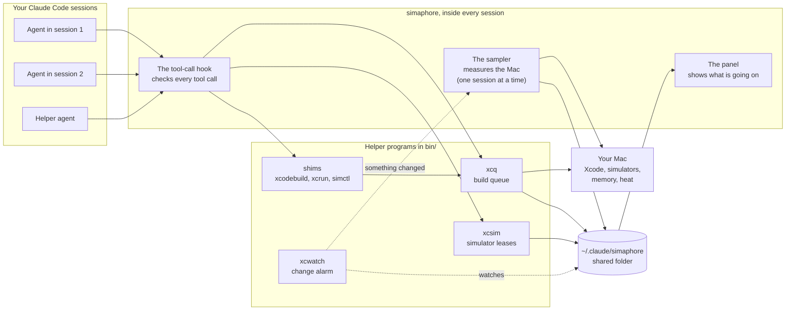

How to read it: agents never touch Xcode directly while simaphore is on. Their calls
pass through the tool-call hook first. The hook uses the helpers to queue builds and hold
simulators, and the helpers write down what they did in the shared folder. One session
also measures the Mac. Every panel then draws from the shared folder.

---

## 4. The parts, one by one

| Part | Where | What it does |
|---|---|---|
| Hook module | `hooks/register.tsx` | The plugin's brain. Claude Code loads it in every session. It runs the tool-call hook, the sampler and the panel. It is the only file in `hooks/` with side effects (it runs commands and writes files). |
| Rules | `hooks/logic.ts`, `hooks/leases.ts`, `hooks/builds.ts`, `hooks/watch.ts` | Pure decisions with no side effects. For example: "which simulator does this command use?", "can this lease be freed?", "who owns this build?" |
| Drawing | `hooks/screen.tsx`, `hooks/settings.tsx` | Turns the data into the panel and the settings view. |
| `xcq` | `bin/xcq` | The build queue. Gives each build a ticket, waits for a free slot, runs the build and writes the result. |
| `xcsim` | `bin/xcsim` | Simulator leases: claim, free, wait, rename, and give names back. |
| `xcode-slot` | `bin/xcode-slot` | Holds a build slot while Xcode's own build tool works, so those builds wait in the same queue. |
| `xcpause` | `bin/xcpause` | Pauses and resumes a running build (used by "Pause all but one"). |
| Shims | `bin/shim/xcodebuild`, `bin/shim/xcrun`, `bin/shim/simctl` | Stand-ins that check commands inside scripts, then call the real tool. |
| `xcwatch` | `bin/xcwatch.swift`, `bin/xcwatch` | A small Swift program. It reports changes (files, simulators, memory, a session ending) the moment they happen. |
| Shared code | `bin/lib.sh` | Shell pieces the helpers share: "is simaphore on?", "may this simulator be used?", locks, waiting. |
| Settings | `.claude-plugin/plugin.json` | The settings and their defaults. You change them in the panel (`o`) or in `/config`. |

---

## 5. On and off

simaphore does nothing until you open the panel. **Opening `/simaphore` in any session
switches it on for every session on the Mac.** It stays on while at least one session
has the panel open.

How sessions know: each open panel leaves a small file in `panels/`, named after its
session and holding that session's process number. simaphore counts as on while at
least one of those processes is still alive. Every helper checks this with the same
test, so they all agree.

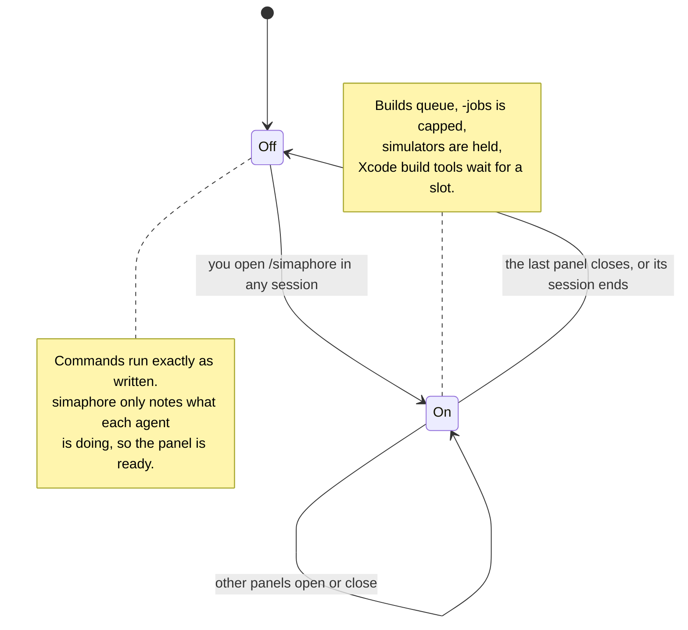

**Switching on** picks up what is already going on:

- A booted simulator that an agent of this session used in the last 5 minutes, or is
  running tests on, is held for that agent.
- Builds that started while simaphore was off count toward the build limit, so new
  builds wait for them.

**Switching off** lets go of everything:

- All leases are freed, and held simulators get their names back.
- Waiting builds start at once. Running builds keep running.
- The "your build is compiling" and "your simulators" notes are deleted.

---

## 6. How it catches commands: the hook and the shims

simaphore catches an agent's calls to `xcodebuild`, `xcrun` and `simctl` before they
reach the real tools. Two parts do this together:

1. **The tool-call hook** sees the command an agent is about to run.
2. **The shims** sit in front of the real tools on PATH. They catch calls the hook
   can't see, such as the ones inside a script.

The hook is what puts the shims in place. It adds a short prefix to the agent's
command, and that prefix puts `bin/shim` first on PATH for that one command. That's why
only Claude Code agents are caught (more on that [below](#what-the-hook-and-shims-dont-reach-codex-copilot-and-your-terminal)).

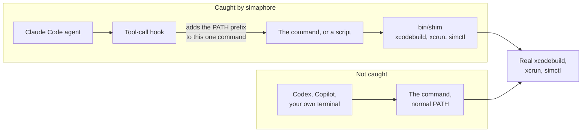

### Part 1: the tool-call hook

Claude Code gives plugins a chance to look at each tool call before it runs. simaphore
uses it. For every Bash command and every Xcode tool call, simaphore decides one of
four things:

| Decision | Example |
|---|---|
| **Let it through** | `ls`, `git status`, or anything at all while simaphore is off. |
| **Change it** | Swap the simulator name `iPhone 17` for its ID. Put the shims first on PATH. Move a build to the background. |
| **Run it later** | The simulator is held by another agent. The command becomes "wait until it is free, then run" and goes to the background. The agent is told when it finishes. |
| **Refuse it** | A command for **all** simulators (`shutdown all`), a simulator reserved for you, or a check that failed. The agent gets a short reason and, for reserved simulators, a free simulator to use instead. |

This is the path a Bash command takes through the hook:

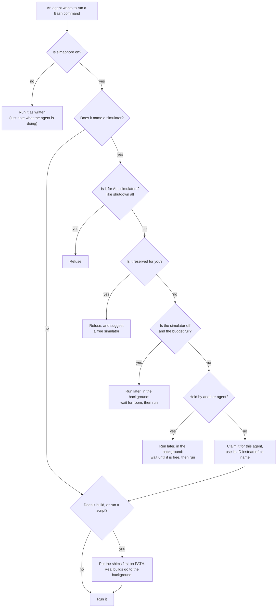

Test commands (`xcodebuild test …`) take a small detour. Instead of the hook claiming
the simulator, the build queue claims it, so a test waits for its simulator and for a
build slot at the same time.

Here is a test run from start to finish:

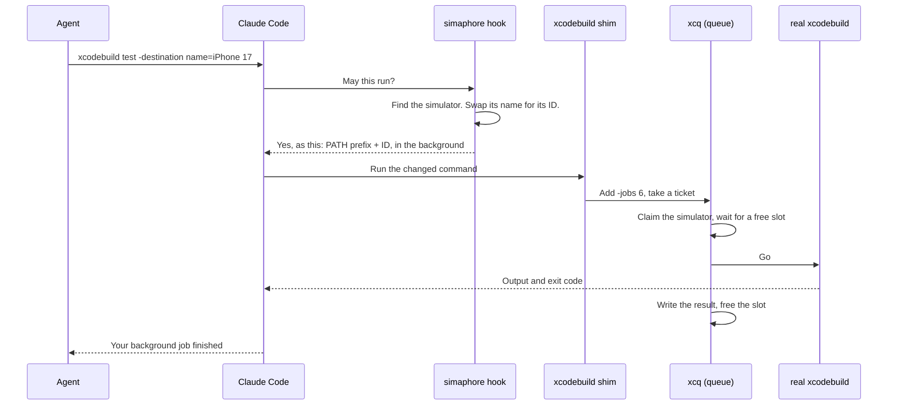

What the PATH prefix is: a short `export PATH=…/bin/shim:"$PATH" XCQ_SESSION=…` at the
front of the command. It puts the shims first in line and passes along who is asking
(session, agent, label) and your settings (`-jobs`, build limit, simulator limit and so
on).

The hook adds it only when a command builds with `xcodebuild` or runs a script: a
`*.sh` file, a path like `./x`, a file run by `bash`, `python`, `ruby`, `node` or
`perl`, `make`, or `fastlane`. Text inside quotes or heredocs doesn't count, so
`echo "xcodebuild"` is left alone.

For **Xcode's own tools** (Xcode's MCP server, which agents can use instead of
`xcodebuild`):

- `BuildProject`, `RunProject`, `RunAllTests` and `RunSomeTests` wait for a build slot
  first. `xcode-slot` holds the slot until the call ends.
- Starting a device session (`DeviceInteractionStartSession` or
  `DeviceInteractionStartWorkspaceSession`) claims the simulator it names.
- These calls can't run later in the background, so a held or full simulator means a
  refusal with a reason, not a wait.

**After every call** the hook marks the simulator as just used, which resets its
10-minute idle timer. If the call was refused after the hook had claimed a simulator
for it, that claim is given back.

### Part 2: the shims

The hook only sees the command the agent typed. If the agent runs `./run_tests.sh`, the
hook can't see the `xcodebuild` and `simctl` lines inside the script. The shims cover
that gap.

The prefix puts `bin/shim` first on PATH, so when the script says `xcodebuild`, it gets
simaphore's shim. The shim checks the command, then hands it to the real tool.

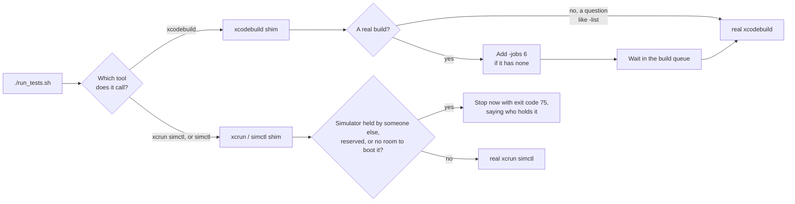

Two things to know:

- Inside a script, simulator commands **never wait**. They stop at once with exit code
  75. A script that waited quietly could hang until the Bash timeout. Exit 75 tells the
  agent clearly what happened.
- Builds inside a script **do** wait in the queue. Run long scripts in the background.

If simaphore is off, the shims hand every command straight to the real tool.

### What the hook and shims don't reach: Codex, Copilot and your terminal

The shims only work when they come first on PATH, and only Claude Code's hook puts them
there. Nothing in `~/.zshrc`, `~/.zshenv` or any other shell file does it. So a command
from another agent tool, or one you type in Terminal, goes straight to the real
`xcodebuild` or `simctl`.

simaphore still **sees** those commands, because the sampler reads every process on the
Mac. It just can't **stop** them. Today:

| What another tool does | What happens |
|---|---|
| Runs `xcodebuild` | It starts at once: no queue, no `-jobs` cap. It still takes up one of the build slots, so Claude builds wait for it. |
| Its build runs inside a terminal app (Terminal, iTerm, Ghostty, Warp, WezTerm, Alacritty, kitty, VS Code or Cursor) | The panel shows it as "You · Terminal", and simaphore treats it as your own build. While it compiles, Claude builds wait (`hold`). |
| Uses a simulator | Nothing checks it. It can use a simulator a Claude agent holds. Even with the shims on PATH, the simulator check does nothing without a session ID (`XCQ_SESSION`), which only Claude's hook sets. |

**Shims for every shell (proposed, not built).** An earlier design session (October
2026) laid out how to bring other agents under the same rules, in stages:

| Stage | What it would add | How |
|---|---|---|
| A. Recognise them | Their builds are labelled by tool instead of "You · Terminal". | Treat processes named `codex`, `copilot`, `gemini`, `opencode`, `aider` or `cursor-agent` as agents. |
| B. Queue their builds | Their `xcodebuild` waits in the same queue. | Put `bin/shim` first on PATH for every shell through `~/.zshenv`. The `xcodebuild` shim already works without a session ID. |
| C. Simulator locks | They hold and respect simulators too. | Make up a session ID from the tool's process ID, and let the simulator check use it. |
| D. Full match | Activity history, helpers, tool-call checks, like Claude. | One adapter per tool, using that tool's own hooks. |

Even stage B can't catch a tool that calls `/usr/bin/xcodebuild` by its full path,
because that skips PATH altogether.

---

## 7. How it knows which simulator an agent is using

It's automatic. Nobody tells simaphore which simulator an agent uses. It finds out in
three ways.

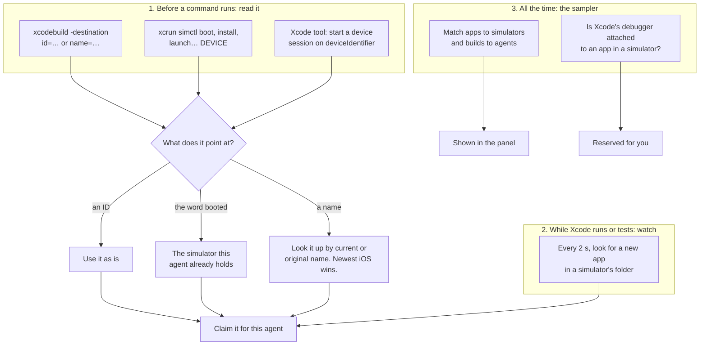

### 1. Reading the command

Before a command runs, simaphore looks for a simulator in its text:

- `xcodebuild test … -destination 'platform=iOS Simulator,id=…'`, or `name=…` (with an
  optional `OS=…`).
- `xcrun simctl <verb> <device>`, for verbs that use a simulator: `boot`, `shutdown`,
  `erase`, `install`, `launch`, `terminate`, `openurl`, `io`, `ui`, `spawn`, `push`,
  `privacy`, `location`, `status_bar`, `addmedia`, and others.
- Xcode's `DeviceInteractionStartSession` and `DeviceInteractionStartWorkspaceSession`,
  through their `deviceIdentifier`.

Then it works out which simulator that is:

- **An ID** (UDID, the long unique code every simulator has): used as is.
- **`booted`**: means "the one I'm already holding". If the agent holds none, nothing
  is claimed.
- **A name**: compared with each simulator's current name and its original name (a held
  simulator is renamed "🔒 label · iPhone 17", so `iPhone 17` must still match it). If
  several share the name, the newest iOS wins and the agent gets a note saying so.

### 2. Watching Xcode runs

When an agent runs or tests through Xcode's tools, Xcode picks the simulator itself.
The command doesn't say which one. So simaphore checks running processes every 2
seconds, looking for a new app inside a simulator's folder
(`…/Devices/<ID>/data/Containers/Bundle/Application/…`). The first one it finds is
claimed for that agent. If another agent already holds that simulator, you get a toast
and the agent is told to pick another run destination. The call itself isn't stopped,
because Xcode had already chosen.

### 3. The sampler, all the time

The sampler (see [section 11](#11-one-leader-many-readers-how-it-stays-live)) checks
the Mac every few seconds, mainly to fill the panel:

- **Apps to simulators**: a process belongs to a simulator if its path holds that
  simulator's ID, or if it was started by that simulator's `launchd_sim`.
- **Builds to agents**: it tries these in order and stops at the first that works:
  1. The build was started by a Claude session simaphore knows.
  2. The build has a queue ticket.
  3. Some Claude process started it.
  4. Its DerivedData folder records a workspace inside an agent's folder.
  5. Its `-workspace` or `-project` path is inside an agent's folder.
  6. It was started by the Xcode app, so it's yours.
- **Your simulators**: if Xcode's debugger is attached to an app in a simulator,
  simaphore treats that simulator as yours and agents are steered away from it. Press
  Stop in Xcode and it's free again within a few seconds.

Each tool call also records what the agent did (build, test, boot, install, launch,
drive, verify, run) and on which simulator. The panel shows that history.

---

## 8. Leases: holding a simulator

A **lease** is a small note saying "this simulator belongs to this agent right now".
It's a file, `leases/<simulator ID>.lease`, with lines like these:

```
udid=8D2C…
session=f2c5…
agent=
label=checkout-flow
originalName=iPhone 17
claimedAt=1793606400
lastUsed=1793606712
```

`agent` is empty for the main agent of a session and set for helper agents (Claude
Code's subagents). Each helper counts as its own holder.

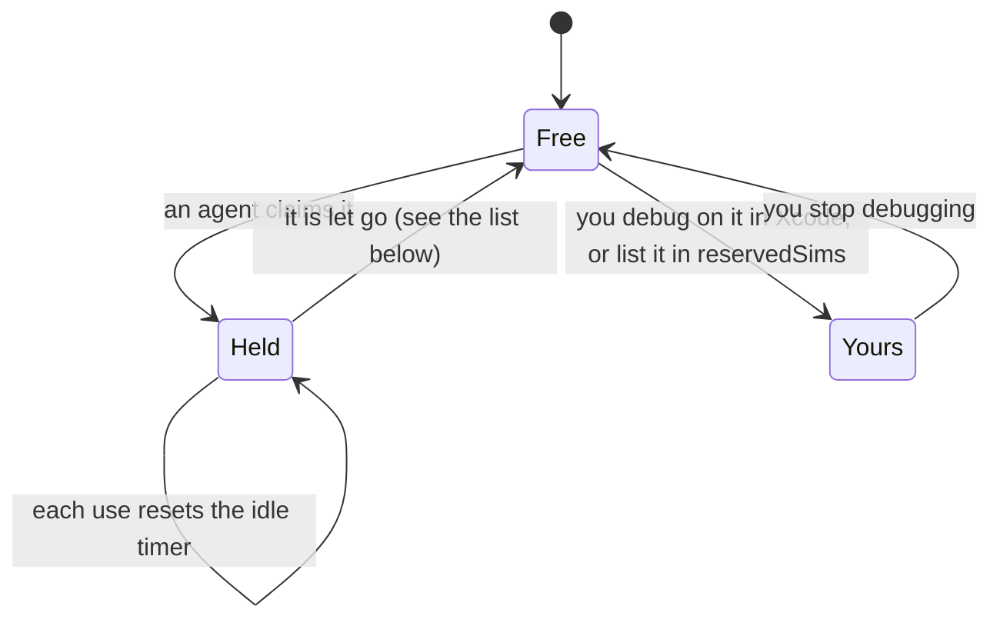

A lease is let go when:

- the agent claims a different simulator (one simulator per agent), unless a running
  build still uses the old one,
- the session ends or its process dies,
- the helper agent finishes its job,
- it has gone unused for 10 minutes and nothing is running on it,
- the simulator is deleted,
- simaphore is switched off.

Guards that stop it from letting go by mistake:

- **Locks.** Every change to a lease takes a lock on that simulator, so two agents
  claiming at the same moment can't both win.
- **Bad readings.** If the process list or the list of agents comes back empty
  (usually a read that failed, not a real change), nothing is freed on that round.
- **Sleep.** After the Mac wakes from sleep (more than 60 seconds between readings),
  nothing is freed for 30 seconds. Otherwise every lease would look 10 minutes idle at
  once.

**Renaming.** With `renameSims` on, a held simulator is renamed "🔒 label · iPhone 17",
so you can see who has it in Xcode and in Simulator.app too. It gets its name back when
freed. A check every 60 seconds also restores any name left behind, for example after a
crash.

---

## 9. The simulator budget

Each booted simulator uses memory. `maxSims` (2 by default) sets how many may be on at
once.

When a command needs a simulator that's off and the budget is already full, the
command waits for room. To make room, simaphore shuts down **one** booted simulator,
but only if all of these are true:

- an agent used it (simaphore never shuts down a simulator only you have used),
- nobody holds it, and it isn't yours,
- nothing is running on it,
- it has been idle for at least 10 minutes.

The one idle longest goes first. If none qualifies, the command keeps waiting, and the
panel warns that the budget is over.

---

## 10. The build queue

Every real build gets a **ticket**, a file in `queue/` that records who asked, the
command, the folder, the simulator and the state (waiting or running). Running tickets
come first, then any ticket marked urgent, then the rest from oldest to newest.

A ticket checks these in order, each time something changes:

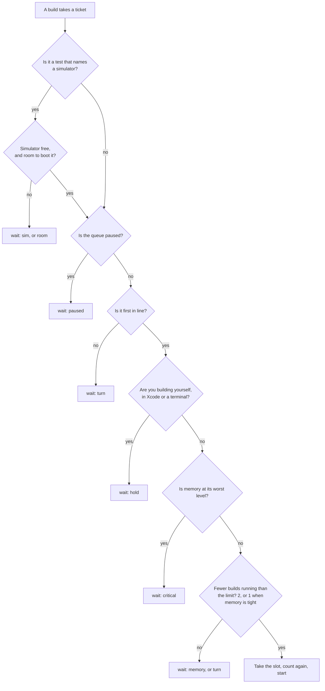

Things worth knowing:

- **Your builds come first.** While a build you started yourself (in Xcode or a
  terminal) is compiling, agent builds wait. The sampler keeps a `hold` file fresh
  while that's true. The queue ignores the file once it is 15 seconds old.
- **Builds outside the queue count.** An `xcodebuild` that started while simaphore was
  off still takes a slot.
- **Two at the same moment.** A ticket takes a slot and then counts again. If two
  tickets grabbed the last slot together, both see it, step back and try again in queue
  order. So the limit holds.
- **Tight memory** means macOS reports memory pressure, or swap use is over
  `swapPercent` (85%). Then only 1 build runs at a time.
- **`-jobs`.** Every queued build gets `-jobs 6` (your `buildJobs` setting) unless it
  already has a `-jobs`. That caps how many files it compiles at once.
- **When a build ends**, the queue writes a result file (`results/<ticket>.json`) with
  the exit code and how long it took. The panel shows it next to the agent. Results are
  deleted after an hour.
- **Pausing.** `p` in the panel pauses the queue (a `queue-paused` file). "Pause all
  but one" freezes running builds with a stop signal and "Resume all" lets them carry
  on. Frozen builds are listed in `paused/`.

---

## 11. One leader, many readers: how it stays live

Every session runs simaphore, but measuring the Mac (processes, memory, simulators)
takes work. Doing it in every session would waste the very resources simaphore is
protecting. So **one session leads**: it measures and writes `latest.json`. The others
just read that file.

The leader holds a small lock file, `sampler.json`, and renews it on every round. It's
created in a way only one session can win. If the leader stops renewing for 10 seconds,
or its process dies, another session takes over.

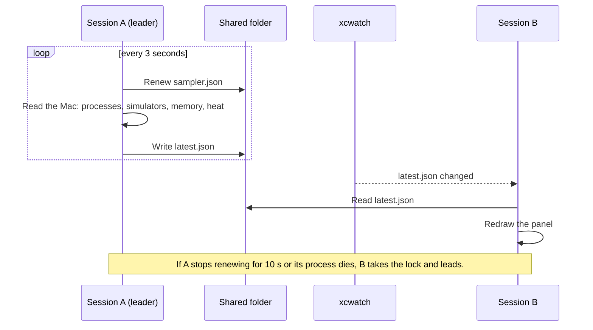

Not everything is read every round. Slow checks run less often:

| What | How often |
|---|---|
| A round (tick) | every 3 s |
| Processes and memory (`ps`, `sysctl`) | every round |
| CPU (`top`) | every 10 s, skipped when the Mac is very busy |
| Simulator list (`simctl list`) | every 10 s. Every 3 s while one boots. Every 30 s when `xcwatch` is running. |
| Heat (`pmset -g therm`) | every 10 s |
| Apps in each simulator | every 5 s |
| Each Claude session's folder (`lsof`) | every 30 s |
| Git branch of each folder | every 30 s |
| Free disk (`df`) | every 60 s |
| Selected Xcode (`xcode-select`) | every 60 s |
| Name check (restore leftover 🔒 names) | every 60 s |
| DerivedData and simulator data size (`du`) | every 15 min |
| Agent heartbeat (each session rewrites its own record) | every 15 s |

**`xcwatch`, the change alarm.** Timers alone would mean waiting up to 3 seconds to see
a change. `xcwatch` is a small Swift program that reports changes as they happen:

- a file changed in `leases/`, `queue/`, `paused/`, `queue-paused` or `latest.json`,
- a simulator booted or shut down,
- memory pressure changed,
- a watched session ended.

simaphore waits 200 ms after a report (several reports often come together) and keeps
rounds at least 1 second apart. If `xcwatch` stops, it's restarted after 1 second, then
2, and so on up to 60. Waiting builds and leases use it too, so they move as soon as a
slot or simulator is free.

The leader also keeps one `log stream` per booted simulator, to see apps come to the
front or go to the background live. Each stream runs under `xcwatch tether`, which
stops it when the session ends, even if the session crashed.

Without `xcwatch` (no Swift compiler, or the build failed) everything still works by
timers, just a few seconds slower.

---

## 12. How it updates itself

"Updating" means two different things here.

### Live data

Covered in [section 11](#11-one-leader-many-readers-how-it-stays-live): a round every 3
seconds, `xcwatch` waking things early, and each session renewing its own agent record
every 15 seconds. An agent whose record is more than 2 minutes old counts as gone.

### New versions of the plugin

simaphore doesn't update its own code. Claude Code's plugin manager does that (install
with `/plugin install simaphore --marketplace omaestra/simaphore`, update from
`/plugin`). Then restart your sessions so they load the new version.

On the next start, simaphore takes care of the rest:

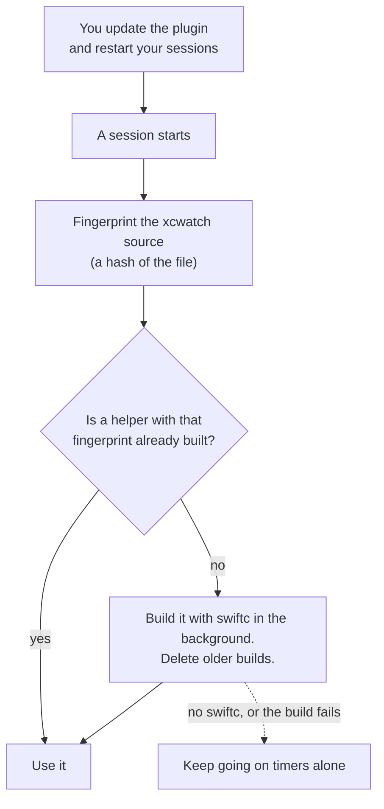

- **`xcwatch` rebuilds itself.** The built helper is named after a fingerprint of its
  source, for example `bin/xcwatch-daefdd67971d`. New source means a new fingerprint, so
  it's built once more and the old copy is deleted. Only one session builds it at a
  time (a lock in `locks/`).
- **Old files still work.** If `latest.json` was written by an older version, missing
  fields are filled with defaults, so the panel doesn't break while sessions on old and
  new versions share the folder.
- **Leases and tickets carry over.** Their format is the same, so an update doesn't free
  anything.
- **A reload in the middle of a session** loses only what was in memory. simaphore picks
  it up again from `latest.json` on the next round.

---

## 13. What it reads

simaphore only reads. It never changes your projects or Xcode settings.

| What it reads | How | Why |
|---|---|---|
| Running processes | `ps` | Find builds, simulators, apps and Claude sessions, and link them to each other. |
| Memory and swap | `sysctl` | The pressure bar, and when to drop to 1 build. |
| CPU | `top` | The CPU line in the header. |
| Heat | `pmset -g therm` | Heat alerts. |
| Simulators | `xcrun simctl list -j` | Which simulators exist, their names, iOS versions and state. |
| Apps in a simulator | `xcrun simctl spawn … launchctl` and `log` | The app line under each simulator, front or suspended. |
| Each session's folder | `lsof` | Which project each agent works in. |
| Git branch | `git` | The branch shown next to each agent. |
| Free disk | `df` | Low-disk warning. |
| DerivedData and simulator data size | `du` | The host line. |
| DerivedData `info.plist` | `plutil` | Which workspace a build belongs to. |
| Xcode window state | `stat` and `grep` on Xcode's `.xcuserstate` | Which Xcode window or workspace an agent used, for the "same window" alert. |
| Selected Xcode | `xcode-select -p` | The Xcode shown in the host line. |
| Tool calls | the hook | What each agent does and on which simulator. Commands are read, never stored in full. |
| Your first prompt | the hook | A short title for the agent row. The prompt itself is never changed. |
| Helper agents | the hook | Each helper's name, from its task description, and when it ends. |
| Its own folder | files in `~/.claude/simaphore` | Leases, tickets, agents, results and `latest.json`. |

---

## 14. What it writes

### Inside `~/.claude/simaphore`

You can move this folder by setting `SIMAPHORE_DIR`.

```
~/.claude/simaphore/
├── latest.json        # the leader's latest reading of the Mac
├── sampler.json       # who leads: session, process, when last renewed
├── events.jsonl       # a log of builds starting and ending, simulators booting and stopping
├── hold               # "you are building": who and since when (only while it's true)
├── reserved           # IDs of simulators you are debugging on in Xcode
├── queue-paused       # present only while the queue is paused
├── agents/<session>.json   # one record per Claude session (see below)
├── panels/<session>        # one file per open panel. Their presence switches simaphore on.
├── leases/<ID>.lease       # who holds each simulator
├── locks/                  # short-lived locks so two writers don't collide
├── queue/<ticket>.ticket   # builds waiting or running
├── results/<ticket>.json   # how each build ended (deleted after an hour)
├── paused/<process>        # builds frozen with "Pause all but one"
└── bin/xcwatch-<hash>      # the built change alarm
```

An agent record looks like this:

```json
{
  "session": "f2c5…",
  "pid": 82350,
  "cwd": "/Users/you/Workspace/my-app",
  "label": "my-app",
  "branch": "main",
  "title": "Fix the checkout crash",
  "lastSeen": 1793606712000,
  "lastToolAt": 1793606700000,
  "activities": [{ "kind": "test", "sim": "8D2C…", "at": 1793606700000 }],
  "subagents": {},
  "endedSubagents": []
}
```

It keeps the last 10 activities, newest first. Each record is written to a temporary
file first and then moved into place, so nobody reads a half-written file. It's deleted
when the session ends. `events.jsonl` keeps growing and is safe to delete.

### Outside the folder

simaphore changes these things on your Mac, and only these:

| Change | When |
|---|---|
| Renames a simulator to "🔒 label · name", and back | When it's held and freed, if `renameSims` is on. |
| Shuts down a simulator | To make room under `maxSims`, or when you press `s` (asks twice). |
| Deletes unavailable simulators | Only when you press `c` (asks twice). |
| Freezes and resumes build processes | Only from the memory alert's "Pause all but one" and "Resume all" buttons. |
| Saves settings | When you change one in the panel. They are stored as `simaphore.*` Claude Code settings, the same ones `/config` shows. |
| Adds `-jobs N` to builds, puts the shims first on PATH | While it's on, for agent commands only. |

Nothing is written into your projects, your Xcode project files or DerivedData.

---

## 15. Safety rules and limits

**Rules it sticks to**

- **Your own commands are never blocked.** Commands you type with `!` go straight
  through.
- **Off means off.** While off, every command runs exactly as written.
- **When unsure, it refuses.** If simaphore can't read the simulator list, can't write
  a lease, or its own check crashes, a command that would take a simulator is refused
  with a reason rather than let through unchecked. Commands that don't touch a
  simulator still run.
- **It doesn't stop running builds.** Switching off, a lease ending or tight memory
  never kills a build. Only "Pause all but one" freezes builds, and "Resume all" or
  switching off undoes it.
- **It doesn't hold Xcode windows.** It only warns when two agents used the same one.

**Known limits**

- Only Claude Code agents are caught. Codex, Copilot and your own terminal commands
  are seen but not queued or checked (see
  [what the hook and shims don't reach](#what-the-hook-and-shims-dont-reach-codex-copilot-and-your-terminal)).
- One simulator per agent. Claiming a second frees the first.
- Builds you start in the Xcode window don't take a queue slot. While they compile,
  agent builds wait (see `hold` above).
- It spots commands by reading their text. A command built to hide itself (with `eval`
  or a variable holding the command name) isn't caught.
- When Xcode's own tools pick a simulator for a run, simaphore can only react after the
  app starts. It can't stop the call.
- Mac only, with Xcode installed, and Claude Code 2.1.275 or later.

---

## 16. Glossary

| Word | Meaning |
|---|---|
| **Agent** | A Claude Code session at work. A session's main agent is labelled with its folder name. |
| **Helper agent** | An agent that a session starts for a side task (a subagent). It holds its own simulator. |
| **Hook** | Code Claude Code runs at certain moments, such as before every tool call. |
| **Shim** | A small stand-in script with the same name as a real tool (`xcodebuild`, `xcrun`, `simctl`). When it comes first on PATH, it gets the call, checks it, then hands it to the real tool. |
| **PATH** | The list of folders your shell searches to find a command. Whichever folder comes first wins. |
| **Lease** | A note saying which agent holds a simulator right now. |
| **Holder** | Whoever has the lease: a session, or a helper agent in that session. |
| **Reserved** | A simulator that's yours: you are debugging on it in Xcode, or it's listed in `reservedSims`. |
| **Ticket** | A build's place in the queue. |
| **Slot** | Permission to run a build now. There are `maxBuilds` of them (1 when memory is tight). |
| **Leader, or sampler** | The one session that measures the Mac and writes `latest.json`. |
| **Tick, or round** | One pass of the sampler, every 3 seconds. |
| **UDID** | A simulator's unique ID, a long code like `8D2C6F1E-…`. |
| **DerivedData** | The folder where Xcode puts build output. |
| **CoreSim** | The macOS service that runs simulators. When it hangs, simulator commands hang too. |
| **Memory pressure** | macOS's own measure of how short memory is: normal, warning or critical. |
| **Swap** | Using the disk as slow extra memory. A lot of swap makes everything slow. |
| **Exit code** | A number a command returns when it ends. 0 means success. simaphore uses 75 for "simulator busy". |
